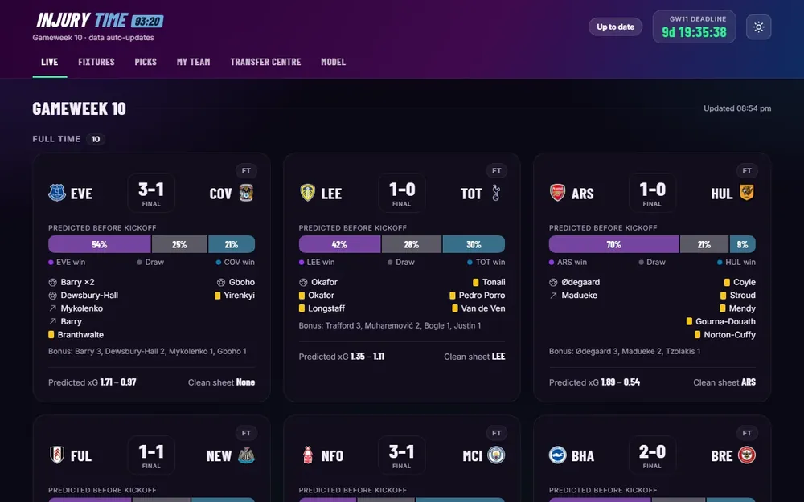
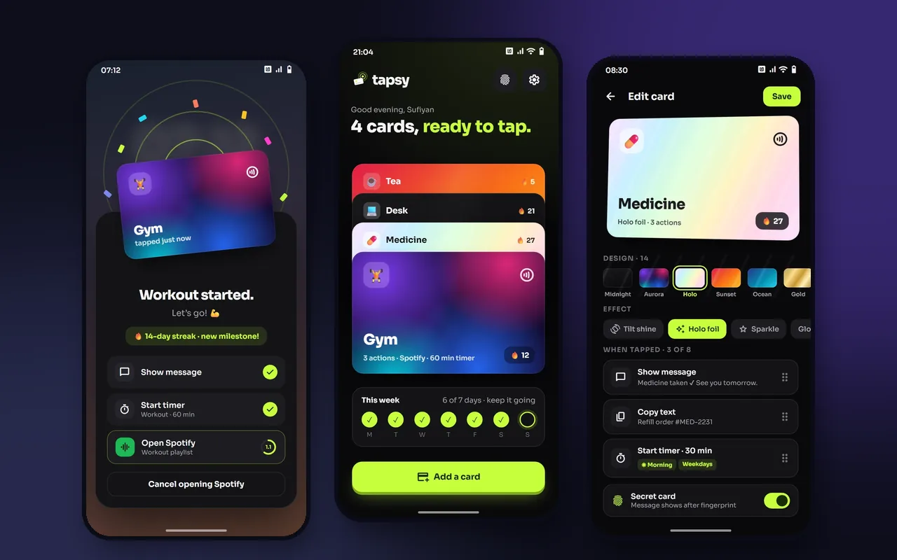
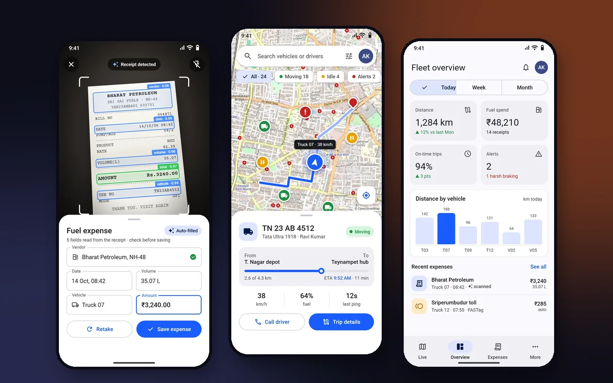
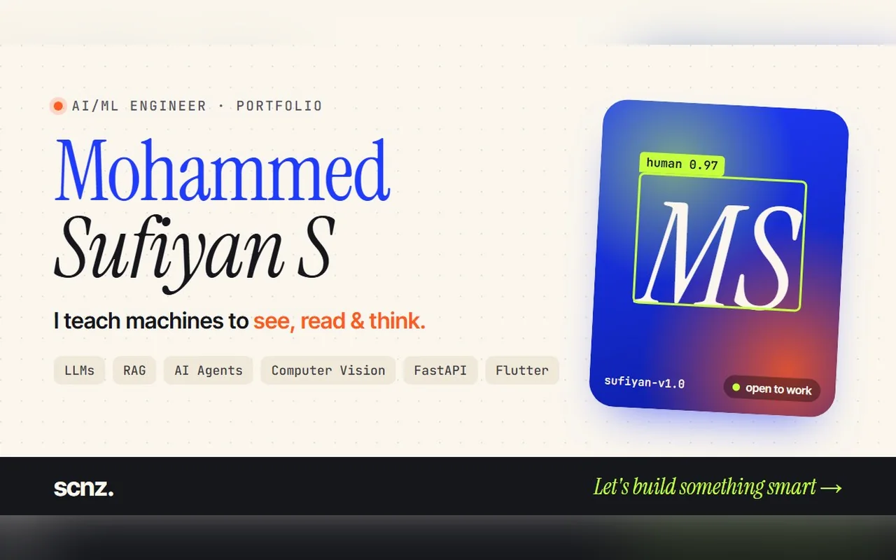

<a href="https://mdsufiyan.pages.dev">
  <picture>
    <source media="(prefers-color-scheme: dark)" srcset="assets/banner-dark.svg">
    
  </picture>
</a>

  
  
  
  

## 🏟️ Kick-off

<table>
<tr>
<td valign="top">

**I build AI that does something useful, then the product around it.** Models first, then the FastAPI backend, then the app people actually tap on.

- 🧠 **Day job:** LLM chatbots, RAG pipelines and computer vision, shipped as full-stack products
- ⚽ **Side project:** [Injury Time](https://github.com/Mohammed-Sufiyan/injury-time), a Premier League predictor within **0.007 log loss of the bookmakers**
- 📱 **Also:** Flutter apps for NFC wallets, fleet tracking and real estate
- 📣 **Open to offers:** roles, projects, or a good argument about who wins the league

</td>
<td width="280" align="center" valign="top">
  
   <i>Ratings are self-assessed. Fun is not negotiable.</i>
</td>
</tr>
</table>

## 🔥 Current form

<table>
<tr>
<td width="50%" valign="top">
  
  <h3>⚽ Injury Time</h3>
  A Dixon-Coles model predicts every Premier League match and turns it into expected FPL points: captain picks, transfer and chip plans, a mini-league tracker.
    
  <a href="https://injury-time-frontend.vercel.app"><b>Live app</b></a> · <a href="https://github.com/Mohammed-Sufiyan/injury-time"><b>Code</b></a>
   Python · Dixon-Coles · FastAPI · Supabase
</td>
<td width="50%" valign="top">
  
  <h3>⚡ Tapsy</h3>
  Turns any NFC card already in your wallet into a magic button: tap it on your phone and actions fire, even with the app closed. Android Keystore encryption, biometric lock, 99 tests.
    
  <a href="https://github.com/Mohammed-Sufiyan/taspy"><b>Code</b></a>
   Flutter · Kotlin · NFC · AES-256-GCM
</td>
</tr>
<tr>
<td width="50%" valign="top">
  
  <h3>🛰️ Fleet GPS Tracker</h3>
  Drivers snap a fuel receipt, AI pulls out vendor, volume and total, and every truck streams its position over WebSockets to a live map.
    
  <a href="https://github.com/Mohammed-Sufiyan/gps_tracking"><b>Code</b></a>
   Flutter · OCR · WebSockets · Riverpod
</td>
<td width="50%" valign="top">
  
  <h3>🌐 This whole portfolio</h3>
  Case studies, a project map, a blog and an AI assistant that answers questions about my work. Runs on Cloudflare Pages and Supabase.
    
  <a href="https://mdsufiyan.pages.dev"><b>Visit it</b></a>
   JavaScript · Supabase · Cloudflare Pages
</td>
</tr>
</table>

## 📋 Team sheet

---

<!-- JOKE:START -->

<b>🤣 My code works and I don't know why.</b> &nbsp;(click for the punchline)

 

**Same as my FPL captain picks.**

New joke every day.

<!-- JOKE:END -->

 

⏱️ <b>90+7'</b> · That's full time. Thanks for staying through injury time.

